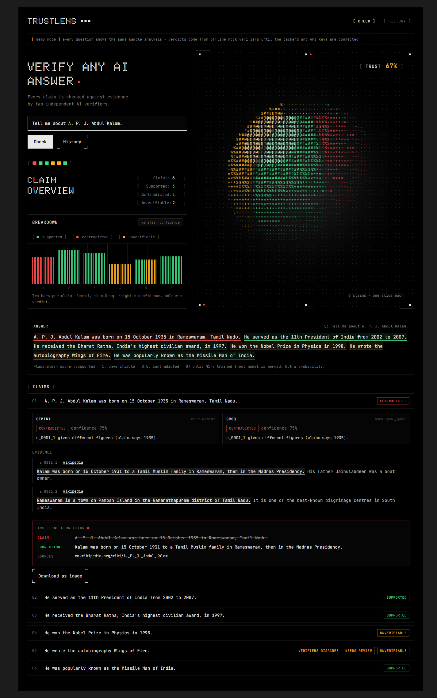
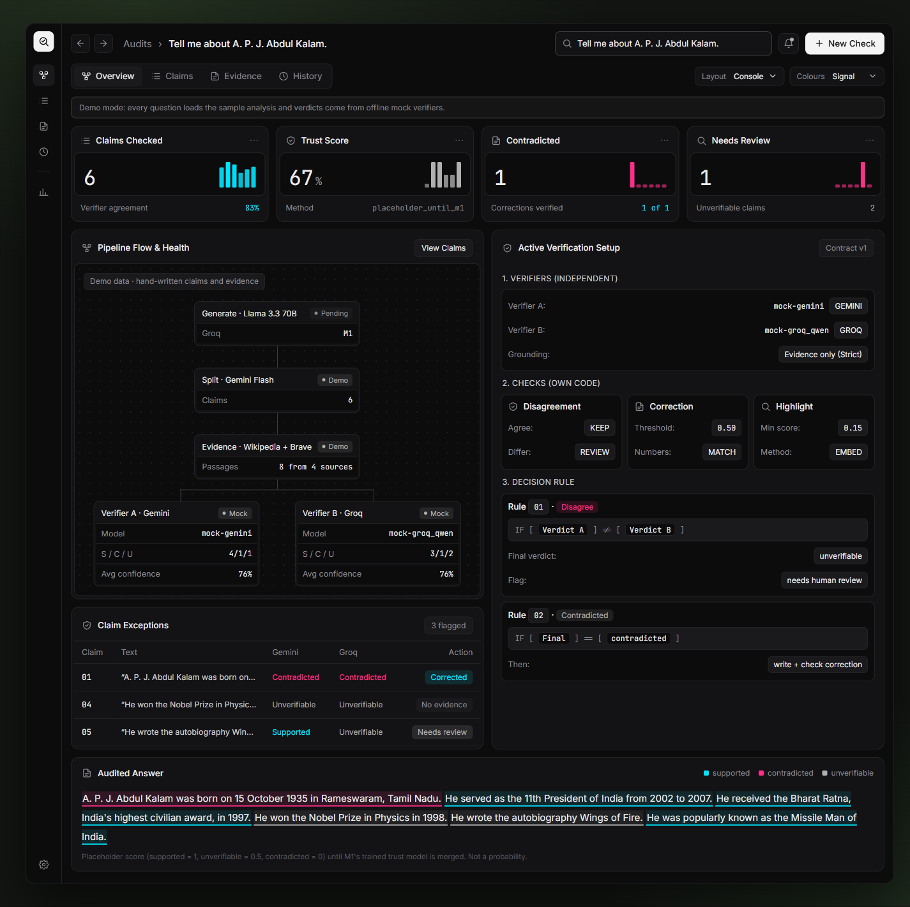
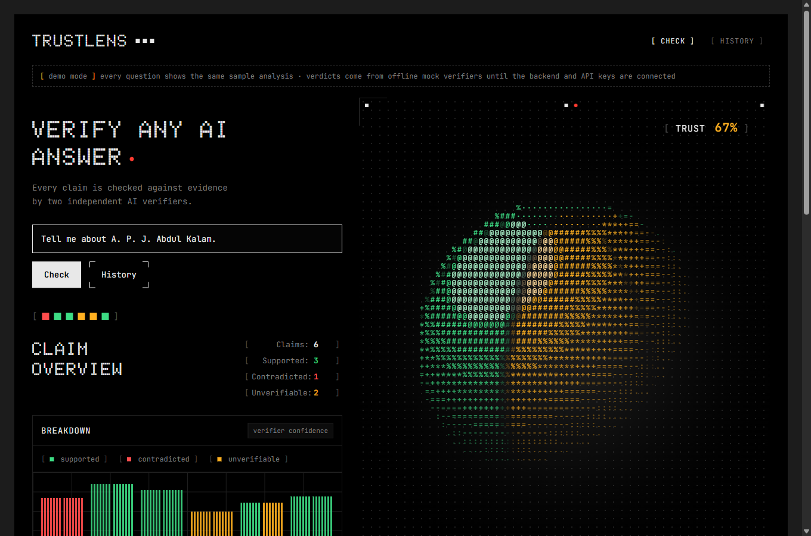
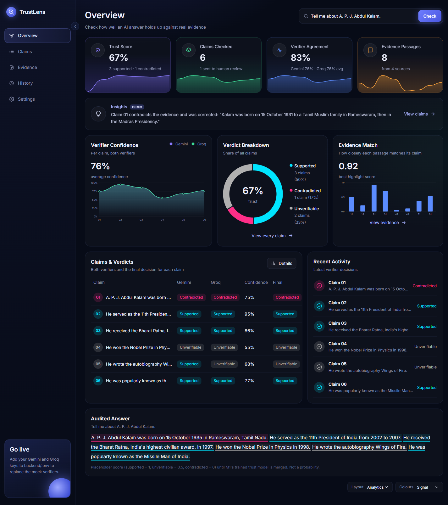
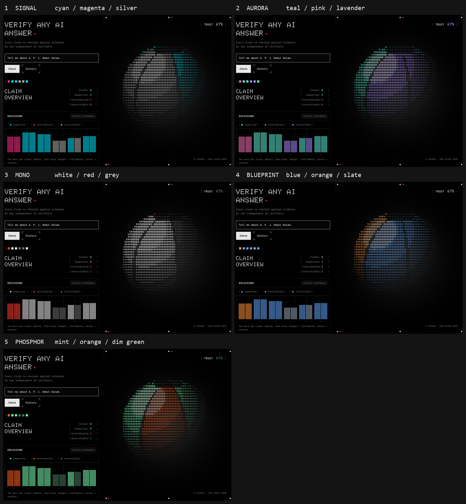
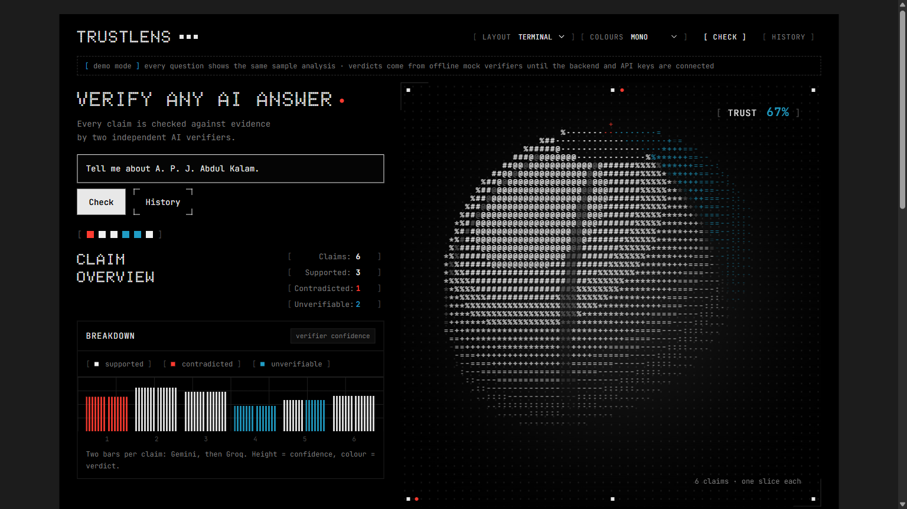

<div align="center">

# 🔍 TrustLens

**An AI fact-checker that doesn't just answer — it proves it.**

TrustLens generates an AI answer, breaks it into individual claims, retrieves evidence for each one, and runs it past two independent verifier models. Every claim gets a verdict. Every false claim gets a correction — and the correction gets checked too.

[](https://www.python.org/)
[](https://fastapi.tiangolo.com/)
[](https://react.dev/)
[](https://www.typescriptlang.org/)
[](LICENSE)

</div>

---

## 🧠 What it does

Most LLMs answer confidently whether they're right or not. TrustLens adds a verification layer on top of any generated answer:

1. **Generate** — an LLM produces an answer to the question.
2. **Split** — the answer is decomposed into individual, checkable claims.
3. **Retrieve** — evidence is pulled for each claim (Wikipedia, optionally Brave Search).
4. **Rank** — evidence is scored with BM25 + embedding similarity to find the most relevant support.
5. **Verify** — two independent models judge each claim against the evidence, with a disagreement rule to flag uncertain calls.
6. **Correct** — false claims get a generated correction, which is itself checked before being shown.
7. **Score trust** — self-consistency, embeddings, and verifier signals are fused into a single trust score per claim.

The result is an answer where every sentence is traceable to evidence — not a black box.

---

## 📸 Screenshots

| Full analysis                          | Console view                    | Claim check                               |
| -------------------------------------- | ------------------------------- | ----------------------------------------- |
|  |  |  |

| Analytics                           | Themes                     | Terminal mode                       |
| ----------------------------------- | -------------------------- | ----------------------------------- |
|  |  |  |

---

## 🏗️ How it works

┌──────────┐ ┌───────────┐ ┌───────────┐ ┌───────────┐ ┌───────────┐
│ Generate │ ─▶ │ Split │ ─▶ │ Retrieve │ ─▶ │ Verify │ ─▶ │ Correct │
│ answer │ │ claims │ │ & rank │ │ claims │ │ & check │
│ │ │ │ │ evidence │ │(2 models) │ │ │
└──────────┘ └───────────┘ └───────────┘ └───────────┘ └───────────┘

- **Answer generation** runs the question through an LLM and samples multiple times to measure self-consistency.
- **Claim splitting & retrieval** break the answer into atomic claims and pull supporting evidence from the web.
- **Ranking** uses BM25 + embedding similarity to surface the most relevant evidence per claim, with a semantic cache to avoid repeat lookups.
- **Verification** runs each claim past two independent models; disagreements between them are explicitly flagged rather than silently resolved.
- **Correction** rewrites false claims and re-checks the correction before it's shown to the user.
- **Trust scoring** combines all of the above signals into a single score per claim, shown alongside the evidence in the UI.

---

## ⚙️ Tech stack

**Backend**

- FastAPI, Pydantic, Uvicorn
- LLM APIs for generation, claim splitting, and verification
- scikit-learn + joblib for the trust-scoring model
- SQLite for history / caching

**Frontend**

- React 19 + TypeScript + Vite
- Vitest + Testing Library for tests
- Custom theming (multiple terminal-style color themes)

---

## 🚀 Getting started

### 1. Clone the repo

```bash
git clone https://github.com/<your-username>/TrustLens.git
cd TrustLens
```

### 2. Backend

```bash
cd backend
python -m venv .venv
.venv/Scripts/python -m pip install -r requirements.txt   # Windows
# source .venv/bin/activate && pip install -r requirements.txt  # macOS/Linux

# run tests
.venv/Scripts/python -m pytest

# try the pipeline with mock verifiers (no API keys needed)
.venv/Scripts/python scripts/demo_m3.py

# run with real API keys (needs backend/.env, see below)
.venv/Scripts/python scripts/demo_m3.py --real

# start the full API server
.venv/Scripts/python -m uvicorn app.main:app --port 8000
```

### 3. Frontend

```bash
cd frontend
npm install
npm test
npm run dev        # http://localhost:5180
```

Set `VITE_USE_MOCK=false` in `frontend/.env.development.local` to point the dev site at the live backend instead of mock data. Free-tier API limits mean each answer is capped at `TRUSTLENS_MAX_CLAIMS` claims (default 6).

> Running the demo script writes `frontend/src/mocks/sampleAnalysis.json`, which the UI uses in demo mode.

---

## 🔑 API keys

Copy `backend/.env.example` to `backend/.env` and fill in:

| Variable                     | Where to get it                                                                                                                            |
| ---------------------------- | ------------------------------------------------------------------------------------------------------------------------------------------ |
| `GEMINI_API_KEY`             | [aistudio.google.com](https://aistudio.google.com) → Get API key (free tier). A Gemini _app_ subscription does **not** include API access. |
| `GROQ_API_KEY`               | [console.groq.com](https://console.groq.com) → API Keys (free tier).                                                                       |
| `GROQ_VERIFIER_MODEL`        | A current non-Llama model from [console.groq.com/docs/models](https://console.groq.com/docs/models).                                       |
| `BRAVE_API_KEY` _(optional)_ | Enables Brave Search as an extra evidence source. Leave empty to use Wikipedia only.                                                       |

Keys live in `.env` only — never commit them.

---

## ☁️ Deployment (Render)

`render.yaml` defines two services:

- **trustlens** — the frontend, built as a static site.
- **trustlens-api** — the backend running the full pipeline.

In Render: **Blueprints → TrustLens blueprint → Manual sync**, then fill in the values marked `sync: false`:

- `GEMINI_API_KEY`, `GROQ_API_KEY`, and optionally `BRAVE_API_KEY` on **trustlens-api**
- `VITE_API_BASE_URL` on **trustlens** — the backend's deployed URL (e.g. `https://trustlens-api-xxxx.onrender.com`)

> On Render's free plan, the backend sleeps when idle (first request after a while takes ~1 minute to wake), and SQLite history resets on each deploy.

---

## 📁 Project structureTrustLens/

├── backend/ # FastAPI server, pipeline logic, tests
│ ├── app/
│ │ ├── services/
│ │ └── models/
│ └── scripts/
├── frontend/ # React + TypeScript UI
├── docs/ # Screenshots and design docs
└── render.yaml # Deployment config

---

## 🤝 Contributing

Issues and pull requests are welcome — open one if you spot a bug or have an idea for an improvement.

---

## 📄 License

[MIT](LICENSE)

</div>
